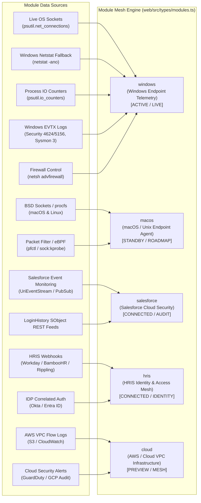
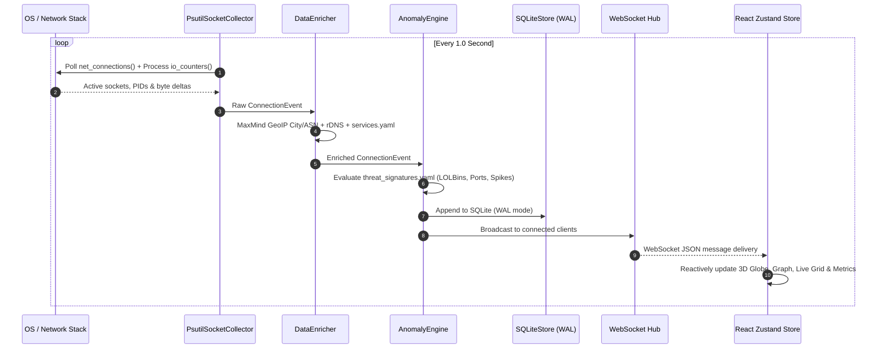

# 🛰️ SignalMap — Architecture & Technical Specification

> **SignalMap** is a high-performance, real-time network traffic intelligence, threat observability, and telemetry platform. It continuously captures host-level socket connections and network I/O, enriches metadata (GeoIP, ASN, reverse DNS, service classification), analyzes traffic streams against an anomaly & threat detection rule engine, persists historical telemetry into SQLite with WAL mode, and renders interactive 3D visualizations (Globe & Topology Graph) alongside executive dashboards, real-time data grids, network diagnostics, and a multi-source module mesh.

---

## 🏗️ 1. High-Level Architecture Overview

```mermaid
flowchart TB
    subgraph IngestionSources["Ingestion Layer & Telemetry Sources"]
        subgraph WindowsModule["Module: Windows Endpoint (Active)"]
            OS_Sockets["Kernel / OS Sockets\n(psutil.net_connections)"]
            Netstat_Fallback["Privileged Netstat Fallback\n(netstat -ano)"]
            Proc_IO["Per-PID & Interface I/O Counters\n(psutil.io_counters)"]
            Sysmon_Logs["Windows EVTX Audit Logs\n(Events 4624, 4625, 5156, Sysmon 3)"]
            Host_Firewall["Host Firewall Remediation\n(netsh advfirewall)"]
        end

        subgraph FutureModules["Future & Extended Modules (Architecture Ready)"]
            Unix_Sockets["macOS / Unix Module\n(BSD Sockets, pfctl, eBPF/auditd)"]
            SaaS_Feeds["Salesforce SaaS Module\n(Event Monitoring, LoginHistory, UriEvent)"]
            Identity_Feeds["HRIS Identity Mesh\n(Workday, BambooHR, Okta/Entra ID)"]
            Cloud_VPC["Cloud VPC & Infrastructure\n(AWS VPC Flow, GuardDuty, GCP Audit)"]
            Universal_Logs["Universal Log Importers\n(Nginx Combined, Universal JSONL, Mock)"]
        end
    end

    subgraph BackendDaemon["Python / FastAPI Backend Daemon (:8765)"]
        CollectorRegistry["Collector & Importer Registry\n(BaseCollector & LogParser)"]
        
        Enricher["DataEnricher\n- MaxMind GeoLite2 (City/ASN)\n- Reverse DNS Caching\n- YAML Service Rules Engine (rules/services.yaml)"]
        
        Anomaly["Anomaly & Threat Engine\n- LOLBin Process Tracing (threat_signatures.yaml)\n- C2 & Backdoor Port Detection\n- SMB WAN Leak Alerting\n- Bandwidth Anomaly Spikes (>100MB)"]
        
        Store["SQLiteStore (WAL Mode)\n- events.db (Indexed Columns)\n- Time-bucketed Aggregation\n- CSV / JSON Exporters"]
        
        RingBuf["In-Memory RingBuffer\n(Bounded to 3,000 Recent Events)"]
        
        subgraph APIServices["API Routing Layer"]
            WSServer["WebSocket Server\n(/api/ws Broadcast)"]
            REST["FastAPI REST Endpoints\n(/api/events, /api/stats, /api/upload)"]
            ActionsAPI["Security Actions API\n(/api/actions/kill-process, /api/actions/block-ip)"]
            NetUtilsAPI["Network Diagnostics API\n(/api/netutils/ping, traceroute, nslookup, whois)"]
        end
    end

    subgraph FrontendSPA["React 18 + TypeScript + Vite Frontend (:5173 / :8765)"]
        LoadingScreen["Antigravity Boot Screen\n(5.0s Exact Lifecycle + Circling Dots Physics)"]
        ZustandStore["Zustand Reactive State Store\n(Events, Filters, Timeline, Themes, Modules, Actions)"]
        
        subgraph UIComponents["Presentation Layer & 7 Primary Workspaces"]
            Sidebar["Left Icon Sidebar\n(7 View Switchers + Settings)"]
            Header["Top Header & Bandwidth Metrics"]
            FilterBar["Filter & Search Bar (Chips, Protocols, Severity)"]
            
            subgraph Viewports["7 Main Viewports"]
                DashboardView["1. Executive Dashboard\n(KPI Cards, Protocol Donut, Severity Gauges, Top Hosts)"]
                GlobeView["2. 3D Earth Globe\n(globe.gl + 2 Themes HUD + Radar Blip Rings)"]
                GraphView["3. 3D Topology Graph\n(react-force-graph-3d + Process/Host Clusters)"]
                TableView["4. Telemetry Stream Tab\n(Summary KPIs + Interactive Telemetry Grid)"]
                PlaybackView["5. Historical Audit Playback\n(Time Scrubber + Density Histogram + 1x-10x Replay)"]
                NetUtilsView["6. Security Diagnostics\n(Ping, Traceroute, DNS, Whois, CIDR, Subnet Calc)"]
                ModulesView["7. Modular Telemetry Hub\n(Multi-source Status, Category Mesh, Source Registry)"]
            end
            
            LiveTable["Docked Live Connection Table\n(Bottom Collapsible Grid for 3D Views)"]
            DetailPanel["Security Detail Slide-over Panel\n(Forensics, Process Kill & Firewall Actions)"]
            SettingsModal["Settings Modal\n(Theme Gallery, Replay Launch Screen, Anomaly Thresholds)"]
            UploadModal["Drag & Drop Offline Log Ingest Modal"]
        end
    end

    %% Ingestion Pipeline Flow
    OS_Sockets -->|1Hz Polling| CollectorRegistry
    Netstat_Fallback -->|Fallback| CollectorRegistry
    Proc_IO -->|Per-PID Deltas| CollectorRegistry
    Sysmon_Logs -->|Multipart Upload / Parse| CollectorRegistry
    Unix_Sockets -.->|Planned Pipeline| CollectorRegistry
    SaaS_Feeds -.->|Planned Pipeline| CollectorRegistry
    Identity_Feeds -.->|Planned Pipeline| CollectorRegistry
    Cloud_VPC -.->|Planned Pipeline| CollectorRegistry
    Universal_Logs -->|Multipart Upload| CollectorRegistry
    
    CollectorRegistry -->|Raw ConnectionEvent| Enricher
    Enricher -->|Enriched Event| Anomaly
    Anomaly -->|Canonical ConnectionEvent| Store
    Anomaly -->|Live Stream Ingest| RingBuf
    
    RingBuf --> WSServer
    Store --> REST
    ActionsAPI --> Host_Firewall
    
    WSServer -->|Live JSON WebSocket Stream| ZustandStore
    REST -->|REST Hydration & Historical Queries| ZustandStore
    ActionsAPI <-->|Execute Remediations| ZustandStore
    NetUtilsAPI <-->|Run Diagnostics| NetUtilsView
    
    ZustandStore --> Sidebar
    ZustandStore --> Header
    ZustandStore --> FilterBar
    ZustandStore --> DashboardView
    ZustandStore --> GlobeView
    ZustandStore --> GraphView
    ZustandStore --> TableView
    ZustandStore --> PlaybackView
    ZustandStore --> NetUtilsView
    ZustandStore --> ModulesView
    ZustandStore --> LiveTable
    ZustandStore --> DetailPanel
    ZustandStore --> SettingsModal
    LoadingScreen -.->|5.0s Completion Gate| FrontendSPA
```



---

## 🧩 2. Core Component Breakdown

### 2.1 Backend Daemon (`agent/`)

| Module | Location | Responsibility |
| :--- | :--- | :--- |
| **Main & Lifecycle** | [`agent/main.py`](file:///c:/Users/User/Documents/MyProject/Antigravity%20DevEX/signalmap/agent/main.py) | Application entrypoint, lifespan startup/shutdown, CORS headers, static SPA bundle mounting for production. |
| **Collector Base** | [`agent/collectors/base.py`](file:///c:/Users/User/Documents/MyProject/Antigravity%20DevEX/signalmap/agent/collectors/base.py) | Abstract base contracts `BaseCollector` (live async stream) and `BaseImporter` (batch parser). |
| **Socket Collector** | [`agent/collectors/socket_collector.py`](file:///c:/Users/User/Documents/MyProject/Antigravity%20DevEX/signalmap/agent/collectors/socket_collector.py) | Active socket poller using `psutil.net_connections()` with automated Windows `netstat -ano` fallback and per-PID `psutil.Process().io_counters()` bandwidth tracking. |
| **Data Enrichment** | [`agent/enrichment.py`](file:///c:/Users/User/Documents/MyProject/Antigravity%20DevEX/signalmap/agent/enrichment.py) | Offline MaxMind GeoIP City & ASN lookup with automatic database download, reverse DNS caching, and rule evaluation against [`rules/services.yaml`](file:///c:/Users/User/Documents/MyProject/Antigravity%20DevEX/signalmap/rules/services.yaml). |
| **Anomaly & Threat Engine** | [`agent/anomaly.py`](file:///c:/Users/User/Documents/MyProject/Antigravity%20DevEX/signalmap/agent/anomaly.py) | Evaluates network events against [`rules/threat_signatures.yaml`](file:///c:/Users/User/Documents/MyProject/Antigravity%20DevEX/signalmap/rules/threat_signatures.yaml): LOLBin execution, C2/backdoor ports, SMB WAN exposure, and >100MB spikes. |
| **Storage Engine** | [`agent/store/sqlite_store.py`](file:///c:/Users/User/Documents/MyProject/Antigravity%20DevEX/signalmap/agent/store/sqlite_store.py) | Asynchronous SQLite store via `aiosqlite` with WAL mode, parameterized schema indexing, density timeline aggregation, and CSV/JSON export. |
| **Log Parsers** | [`agent/parsers/`](file:///c:/Users/User/Documents/MyProject/Antigravity%20DevEX/signalmap/agent/parsers) | Ingestion engine supporting Windows EVTX (Events 4624, 4625, 5156, Sysmon 3), Nginx Combined access logs, and universal JSON Lines format. |
| **WebSocket Hub** | [`agent/api/ws.py`](file:///c:/Users/User/Documents/MyProject/Antigravity%20DevEX/signalmap/agent/api/ws.py) | Real-time WebSocket connection manager broadcasting normalized JSON `ConnectionEvent` payloads to all connected clients. |
| **Security Actions API** | [`agent/api/actions.py`](file:///c:/Users/User/Documents/MyProject/Antigravity%20DevEX/signalmap/agent/api/actions.py) | Endpoints for active host containment: process termination (`/api/actions/kill-process`) and dynamic host firewall blocking via Windows `netsh advfirewall` or Linux `iptables` (`/api/actions/block-ip`). |
| **Network Diagnostics API** | [`agent/api/netutils.py`](file:///c:/Users/User/Documents/MyProject/Antigravity%20DevEX/signalmap/agent/api/netutils.py) | Diagnostic tools running server-side subprocesses for Ping, Traceroute, DNS lookup, Whois, CIDR subnet calculation, and PoP geo-resolution. |

---

### 2.2 Frontend Application (`web/src/`)

```
web/src/
├── components/
│   ├── LoadingScreen.tsx       # 5.0s Antigravity boot sequence with logo & mouse-circling dots
│   ├── Sidebar.tsx             # 7-view left navigation bar, alert badges, and settings modal trigger
│   ├── Header.tsx              # Live throughput meters, threat severity counters, and quick actions
│   ├── FilterBar.tsx           # Search input, protocol filters, category chips, and CSV/JSON export
│   ├── DashboardView.tsx       # View 1: Executive KPI overview, protocol distribution, and threat matrix
│   ├── GlobeView.tsx           # View 2: 3D Earth globe with 2 themes HUD (Black Dots & Blue Marble)
│   ├── GraphView.tsx           # View 3: 3D Force-directed process-to-service topology graph
│   ├── TableView.tsx           # View 4: Full-viewport connection telemetry grid with metric cards
│   ├── PlaybackView.tsx        # View 5: Time scrubber, traffic density histogram, and historical replay
│   ├── NetworkUtils.tsx        # View 6: Suite of security diagnostics (Ping, Traceroute, DNS, CIDR)
│   ├── ModulesView.tsx         # View 7: Modular telemetry mesh hub, status cards, and source inspector
│   ├── LiveConnectionTable.tsx # Collapsible docked live telemetry grid for 3D views
│   ├── ConnectionTable.tsx     # Reusable data grid with column sorting, filtering, and row selection
│   ├── DetailPanel.tsx         # Slide-over forensics inspector with MITRE tags and remediation triggers
│   ├── SettingsModal.tsx       # Cyber-themed settings modal with 2-theme globe gallery & replay button
│   └── UploadModal.tsx         # Drag-and-drop log import modal (EVTX, Nginx, JSONL)
├── stores/
│   └── connectionStore.ts      # Unified Zustand reactive state store (events, filters, themes, modules)
├── types/
│   ├── modules.ts              # SystemModule schemas, categories, capabilities, and module definitions
│   └── globeTheme.ts           # 2 Globe theme definitions (Black Dots & Blue Marble), colors, radar fx
├── hooks/
│   ├── useWebSocket.ts         # Resilient WebSocket client with automatic reconnection
│   └── useConnections.ts       # Initial REST batch hydration and buffer syncing
└── index.css                   # Dark mode design tokens, glassmorphism, and cybernetic glows
```

---

## 🔌 3. Modular Architecture & Data Sources

SignalMap is architected around an extensible **Module Mesh System**. Every module represents a distinct telemetry domain (host endpoints, SaaS environments, identity providers, or cloud VPC networks).

Every module consumes one or more **Data Sources** and maps them to the canonical `ConnectionEvent` schema.



### 3.1 Deep Dive: Current Active Module — Windows Endpoint (`windows`)

The **Windows Endpoint Telemetry** module is fully implemented, continuously active, and serves as the primary live telemetry engine.

| Source ID | Source Name | Mechanism | Telemetry Extracted | Path / File |
| :--- | :--- | :--- | :--- | :--- |
| `src:win:psutil` | **Live OS Sockets** | 1Hz async poller via `psutil.net_connections(kind="inet")` | Local IP/port, Remote IP/port, Protocol (TCP/UDP), Socket State (ESTABLISHED, LISTEN, SYN_SENT), Associated Process PID. | [`agent/collectors/socket_collector.py`](file:///c:/Users/User/Documents/MyProject/Antigravity%20DevEX/signalmap/agent/collectors/socket_collector.py) |
| `src:win:netstat` | **Privileged Fallback Netstat** | `subprocess.check_output(['netstat', '-ano'])` with regex normalization | Fallback socket enumeration when standard user context encounters Windows `psutil.AccessDenied`. | [`agent/collectors/socket_collector.py`](file:///c:/Users/User/Documents/MyProject/Antigravity%20DevEX/signalmap/agent/collectors/socket_collector.py#L59-L97) |
| `src:win:io` | **Process & Interface I/O** | `psutil.Process(pid).io_counters()` delta cache + system `psutil.net_io_counters()` | True per-process bandwidth deltas (`read_bytes`, `write_bytes`), packets transferred, and duration. | [`agent/collectors/socket_collector.py`](file:///c:/Users/User/Documents/MyProject/Antigravity%20DevEX/signalmap/agent/collectors/socket_collector.py#L163-L187) |
| `src:win:evtx` | **Windows EVTX & Sysmon Logs** | Native binary EVTX parsing via `python-evtx` / `agent/parsers/windows_evtx.py` | - **Event 4624**: Successful Account Logon (IP, user, logon type)<br>- **Event 4625**: Failed Logon / Brute Force (workstation, IP, failure code)<br>- **Event 5156**: WFP Permitted Connection (filter run ID, direction, app path)<br>- **Sysmon Event 3**: Network Connection Detected (command line, image, user). | [`agent/parsers/windows_evtx.py`](file:///c:/Users/User/Documents/MyProject/Antigravity%20DevEX/signalmap/agent/parsers/windows_evtx.py) |
| `src:win:firewall` | **Host Firewall Remediation** | Subprocess execution: `netsh advfirewall firewall add rule` | Active threat containment: isolates malicious remote IPs or blocks compromised ports on demand. | [`agent/api/actions.py`](file:///c:/Users/User/Documents/MyProject/Antigravity%20DevEX/signalmap/agent/api/actions.py#L104-L144) |

---

### 3.2 Extended & Future Modules (Architecture Ready)

The SignalMap data model and frontend presentation layer are decoupled and pre-configured to ingest telemetry from the following planned modules:

#### 1. macOS & Unix Endpoint Agent (`macos`) — `[STANDBY / CROSS-PLATFORM]`
- **Source 1: BSD Sockets & procfs**: Polling Darwin kernel sockets via `psutil` and Linux `/proc/net/tcp` & `/proc/net/udp` tables for low-overhead socket detection.
- **Source 2: Packet Filter (pfctl) & eBPF**: Capturing kernel-level socket transitions via macOS `pfctl -sr` and Linux eBPF tracepoints (`sock:inet_sock_set_state`).
- **Source 3: Auditd & Launchd**: Tracking process parent-child execution trees and daemon network behavior.
- **Source 4: Unix Firewall Actions**: Executing `pfctl` anchor rules on macOS and `iptables` / `nftables` on Linux.

#### 2. Salesforce Cloud Security (`salesforce`) — `[CONNECTED / SAAS AUDIT]`
- **Source 1: Real-time Event Monitoring (Pub/Sub & CometD)**: Subscribing to `UriEventStream` and `LightningEventStream` for live API operations and data access queries.
- **Source 2: LoginHistory SObject Feed**: Extracting user logins, client IP addresses, authentication methods, and impossible-travel geo coordinates.
- **Source 3: ReportExportEvent Audit**: Monitoring large-scale database and customer record exports to identify insider exfiltration.

#### 3. HRIS Identity & Access Mesh (`hris`) — `[CONNECTED / IDENTITY CORRELATION]`
- **Source 1: HRIS Webhooks (Workday, BambooHR, Rippling)**: Ingesting employee status changes (employment verification, termination, department changes).
- **Source 2: IDP Authentication Logs (Okta, Microsoft Entra ID)**: Correlating machine-level network socket connections with verified authenticated identities.
- **Source 3: Off-Hours Activity Detection**: Flagging internal socket traffic generated by terminated accounts or outside standard business hours.

#### 4. Cloud Infrastructure & VPC Mesh (`cloud` / AWS / GCP / Azure) — `[PREVIEW / INFRASTRUCTURE]`
- **Source 1: AWS VPC Flow Logs**: Ingesting flow records (srcaddr, dstaddr, srcport, dstport, protocol, bytes, packets, action).
- **Source 2: Cloud Security Findings (AWS GuardDuty & GCP Cloud Audit)**: Ingesting high-priority reconnaissance and exfiltration findings.
- **Source 3: Transit Gateway & Azure VNet Flow Feeds**: Tracking cross-region and cross-VPC data routing.

#### 5. Universal & Offline Importers
- **Nginx Combined Access Logs**: Ingestion of web server reverse proxy logs via [`agent/parsers/nginx.py`](file:///c:/Users/User/Documents/MyProject/Antigravity%20DevEX/signalmap/agent/parsers/nginx.py).
- **Universal JSON Lines (JSONL)**: High-speed ingestion of pre-formatted or legacy telemetry via [`agent/parsers/jsonl.py`](file:///c:/Users/User/Documents/MyProject/Antigravity%20DevEX/signalmap/agent/parsers/jsonl.py).
- **High-Fidelity Mock Generator**: Deterministic simulation of multi-protocol enterprise traffic for airgapped demonstrations via [`agent/mock_generator.py`](file:///c:/Users/User/Documents/MyProject/Antigravity%20DevEX/signalmap/agent/mock_generator.py).

---

### 3.3 Developer Guide: How to Implement and Plug In a New Module

Adding a new module to SignalMap requires 4 standard steps:

1. **Implement Collector or Parser**:
   Create a class implementing `BaseCollector` (for streaming) or `LogParser` (for log files):
   ```python
   # agent/collectors/my_module_collector.py
   from .base import BaseCollector
   from ..schema import ConnectionEvent, LocalEndpoint, RemoteEndpoint

   class MyModuleCollector(BaseCollector):
       name = "my_module"
       async def events(self) -> AsyncIterator[ConnectionEvent]:
           # Yield normalized ConnectionEvent instances
           yield ConnectionEvent(...)
   ```

2. **Register Source Collector in Canonical Schema**:
   Add the collector key to `source_collector` in [`agent/schema.py`](file:///c:/Users/User/Documents/MyProject/Antigravity%20DevEX/signalmap/agent/schema.py) and re-generate TypeScript definitions:
   ```powershell
   python -m agent.schema
   ```

3. **Wire into Backend Lifespan**:
   In [`agent/main.py`](file:///c:/Users/User/Documents/MyProject/Antigravity%20DevEX/signalmap/agent/main.py), instantiate the collector and register its stream into `store.append(event)` and `ws.broadcast_event(event)`.

4. **Register Module in Frontend Mesh**:
   Add the module descriptor to `SYSTEM_MODULES` in [`web/src/types/modules.ts`](file:///c:/Users/User/Documents/MyProject/Antigravity%20DevEX/signalmap/web/src/types/modules.ts). The frontend [ModulesView.tsx](file:///c:/Users/User/Documents/MyProject/Antigravity%20DevEX/signalmap/web/src/components/ModulesView.tsx) will automatically render the module card, telemetry types, status badge, and filter hooks.

---

## 📐 4. Canonical Data Schema & Types

Defined in Python using Pydantic v2 in [`agent/schema.py`](file:///c:/Users/User/Documents/MyProject/Antigravity%20DevEX/signalmap/agent/schema.py) and transpiled to TypeScript in [`shared/types.ts`](file:///c:/Users/User/Documents/MyProject/Antigravity%20DevEX/signalmap/shared/types.ts):

```typescript
export interface ConnectionEvent {
    id: string;                      // UUIDv4 event identifier
    timestamp?: string;              // ISO 8601 UTC timestamp
    source_collector: string;        // 'psutil_sockets' | 'windows_evtx' | 'nginx' | 'jsonl' | 'salesforce' | 'mock'
    direction?: 'inbound' | 'outbound';
    state?: 'active' | 'closed';
    protocol?: 'tcp' | 'udp' | 'http' | 'https' | 'ws' | 'wss';
    local?: {
        pid?: number | null;
        process_name?: string | null;
        host?: string | null;
        port?: number | null;
    };
    remote?: {
        ip?: string | null;
        hostname?: string | null;
        port?: number | null;
    };
    geo?: {
        lat?: number | null;
        lon?: number | null;
        country?: string | null;
        city?: string | null;
    };
    asn?: {
        number?: number | null;
        org?: string | null;
    };
    service?: {
        name?: string | null;
        category?: 'finance' | 'crm' | 'dev' | 'comms' | 'cloud' | 'cdn' | 'other';
    };
    metrics?: {
        bytes_in?: number;
        bytes_out?: number;
        packets?: number;
        first_seen?: string | null;
        last_seen?: string | null;
    };
    anomaly?: {
        is_anomaly?: boolean;
        severity?: 'low' | 'medium' | 'high' | 'critical';
        title?: string;
        description?: string | null;
        rule?: string | null;
        tags?: string[];
    };
}
```

---

## ⚡ 5. Data Pipelines & Execution Flows

### 5.1 Real-Time Streaming Pipeline



### 5.2 Historical Playback & Query Pipeline

1. **Timeline Scrubber**: User drags the scrubber or toggles **Play (1x - 10x)** on the `TimelineBar`.
2. **Time Window Filter**: Zustand store sets `playbackTime`. Components filter visible events where event `timestamp <= playbackTime`.
3. **Density Histogram**: The backend calculates time-bucketed counts via `GET /api/events/timeline?buckets=30` and displays traffic density peaks and threat concentrations.
4. **Data Exporter**: Users can export filtered or complete datasets to CSV/JSON via `GET /api/events/export`.

---

## 🛡️ 6. Threat & Anomaly Detection Rules

Defined in [`rules/threat_signatures.yaml`](file:///c:/Users/User/Documents/MyProject/Antigravity%20DevEX/signalmap/rules/threat_signatures.yaml) and evaluated in [`agent/anomaly.py`](file:///c:/Users/User/Documents/MyProject/Antigravity%20DevEX/signalmap/agent/anomaly.py):

| Threat ID | Rule Name | Detection Logic | Severity | MITRE ATT&CK |
| :--- | :--- | :--- | :--- | :--- |
| `ANOMALY_LOLBIN` | Suspicious Process Outbound | Known LOLBin binaries (`powershell.exe`, `cmd.exe`, `rundll32.exe`, `certutil.exe`, `mshta.exe`, `regsvr32.exe`, etc.) initiating outbound external connections. | `high` / `critical` | `T1059`, `T1218` |
| `ANOMALY_C2_PORT` | High-Risk / C2 Port | Outbound connection to known C2/backdoor ports (`4444`, `1337`, `31337`, `6667`, `5555`, `23`). | `critical` | `T1571`, `T1071` |
| `ANOMALY_SMB_WAN` | SMB WAN Leak | Direct outbound traffic over ports `445` or `139` targeting non-RFC1918 public IP addresses. | `high` | `T1048`, `T1021.002` |
| `ANOMALY_BANDWIDTH` | Bandwidth Spike | Single connection transfer exceeding 100MB (`bytes_out + bytes_in > 100MB`). | `medium` | `T1048` |
| `ANOMALY_RAW_IP` | Direct Raw IP Outbound | Direct outbound connection to unclassified public IP with no reverse DNS or known service mapping. | `low` | `T1071` |

---

## 🌍 7. 3D Visual Engine & Multi-Theme System

The 3D Globe visualization in [`web/src/components/GlobeView.tsx`](file:///c:/Users/User/Documents/MyProject/Antigravity%20DevEX/signalmap/web/src/components/GlobeView.tsx) is powered by `globe.gl` and Three.js with an integrated **2-Theme Curated Visual Engine** defined in [`web/src/types/globeTheme.ts`](file:///c:/Users/User/Documents/MyProject/Antigravity%20DevEX/signalmap/web/src/types/globeTheme.ts):

| Theme ID | Name | Aesthetics & Atmosphere | Radar Rings | Textures |
| :--- | :--- | :--- | :--- | :--- |
| `black-dots` | **Black Dots** | Pitch black void sphere, over 24,000 fine silver-white starlight continent dots (matching `download.png`), pure obsidian ocean, and delicate ethereal halo rim. | Silver starlight ripple rings (`rgba(226, 232, 240, 0.65)`) | `earth-black-dots.png` (Canvas generated high-density starlight lattice) |
| `classic` | **Blue Marble** | High-resolution NASA Blue Marble daytime earth with topographical elevation relief bump mapping and natural sky blue atmosphere (`#4fc3f7`). | Cyan aerospace beacon rings (`rgba(6, 182, 212, 0.7)`) | `earth-blue-marble.jpg` + Bump: `earth-topology.png` |

### Antigravity Loading Sequence
The startup sequence in [`web/src/components/LoadingScreen.tsx`](file:///c:/Users/User/Documents/MyProject/Antigravity%20DevEX/signalmap/web/src/components/LoadingScreen.tsx) runs an exact 5.0-second initialization lifecycle with 5 stages (`INITIALIZING`, `CONNECTING`, `CALIBRATING`, `SYNCHRONIZING`, `READY`), featuring a SignalMap vector shield logo and 58 multi-colored particles orbiting exclusively around the mouse cursor with fluid Simplex noise turbulence.

---

## 💻 8. Development, Testing & Verification

```powershell
# 1. Dev Mode (Starts FastAPI Backend on :8765 and Vite on :5173)
python start.py

# 2. Production Mode (Builds web/ and serves frontend directly via FastAPI)
python start.py --prod

# 3. Run Backend Test Suite
pytest agent/tests/

# 4. Regenerate TypeScript interfaces from Python schema
python -m agent.schema

# 5. Run Frontend Build Verification
cd web && npm run build
```

---

## 🔒 9. Security, Concurrency & Performance Guardrails

- **WAL Mode Persistence**: SQLite runs with `PRAGMA journal_mode=WAL;` and `PRAGMA synchronous=NORMAL;` for non-blocking concurrent reads and writes.
- **In-Memory Ring Buffering**: Memory footprint is bounded to `MAX_EVENTS = 3000` in both frontend and backend to prevent unbounded memory growth.
- **Protected Process Guardrail**: The Actions API (`/api/actions/kill-process`) prevents accidental termination of critical Windows system binaries (`system`, `csrss.exe`, `wininit.exe`, `lsass.exe`, `svchost.exe`, `explorer.exe`).
- **Airgapped & Offline Compliance**: All textures, GeoIP lookups, and particle shaders run 100% locally with zero external runtime CDN dependencies.

---

## 📝 10. Architectural Maintenance Invariant

> [!IMPORTANT]
> **Documentation Invariant**: Whenever a new module, parser, collector, API endpoint, or visual presentation layer is created, refactored, or extended in the SignalMap codebase, **this document (`architecture.md`) MUST be updated in the same change** to maintain its role as the authoritative single source of architectural truth.
