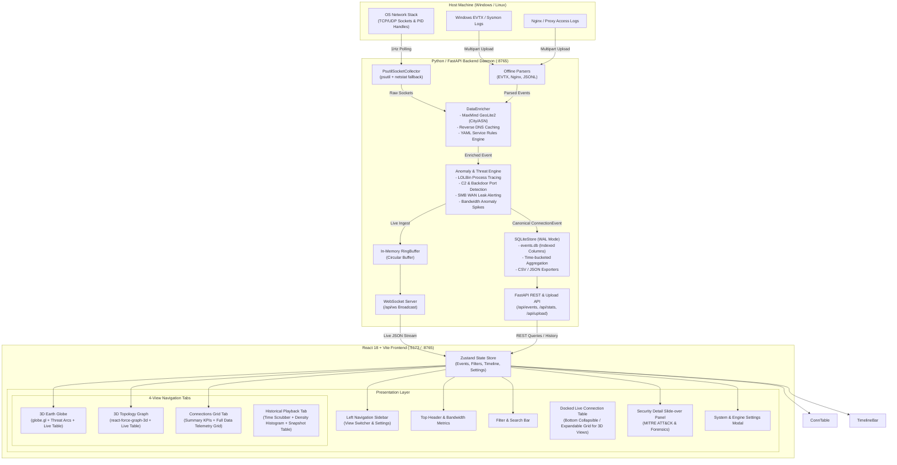
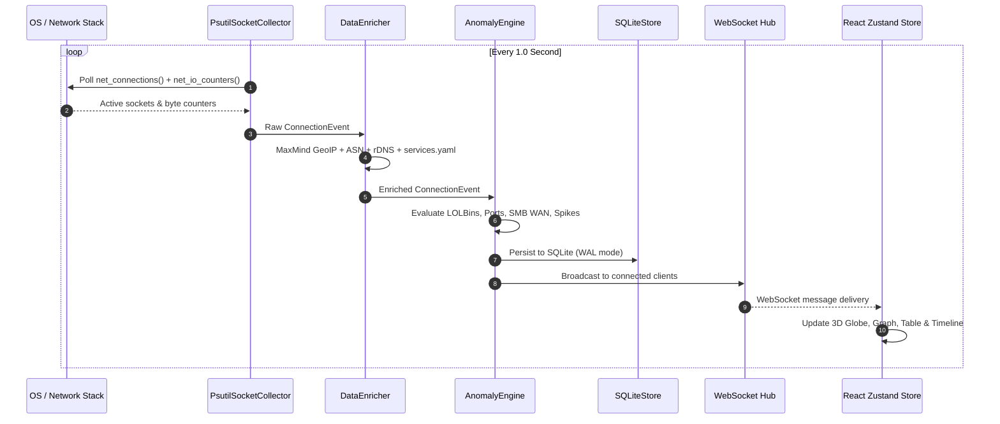

# 🛰️ SignalMap — Architecture & Technical Specification

> **SignalMap** is a high-performance, real-time network traffic intelligence and visualization platform. It continuously captures host-level socket connections and network I/O, enriches metadata (GeoIP, ASN, reverse DNS, service classification), analyzes traffic streams against an anomaly & threat detection rule engine, persists historical telemetry into SQLite with WAL mode, and renders interactive 3D visualizations (Globe & Topology Graph) alongside real-time data grids.

---

## 🏗️ 1. High-Level Architecture Overview



---

## 🧩 2. Component Breakdown

### 2.1 Backend Daemon (`agent/`)

| Module | Location | Responsibility |
| :--- | :--- | :--- |
| **Main & Lifecycle** | [`agent/main.py`](file:///c:/Users/User/Documents/MyProject/My%20Idea/Antigravity%20project/signalmap/agent/main.py) | FastAPI application entrypoint, lifespan startup/shutdown, CORS, static file serving in production mode. |
| **Socket Collector** | [`agent/collectors/socket_collector.py`](file:///c:/Users/User/Documents/MyProject/My%20Idea/Antigravity%20project/signalmap/agent/collectors/socket_collector.py) | Cross-platform socket poller using `psutil.net_connections()` with automated Windows `netstat -ano` fallback and per-second throughput delta calculation via `psutil.net_io_counters()`. |
| **Data Enrichment** | [`agent/enrichment.py`](file:///c:/Users/User/Documents/MyProject/My%20Idea/Antigravity%20project/signalmap/agent/enrichment.py) | Offline MaxMind GeoIP City & ASN lookup with automatic downloads, reverse DNS pointer caching, and YAML-based rule matching against [`rules/services.yaml`](file:///c:/Users/User/Documents/MyProject/My%20Idea/Antigravity%20project/signalmap/rules/services.yaml). |
| **Anomaly Engine** | [`agent/anomaly.py`](file:///c:/Users/User/Documents/MyProject/My%20Idea/Antigravity%20project/signalmap/agent/anomaly.py) | Threat rules evaluating outbound LOLBin processes, known C2/trojan ports, WAN-exposed SMB/NetBIOS, bandwidth transfer spikes (>100MB), and direct unclassified external IP connections. |
| **Storage Engine** | [`agent/store/sqlite_store.py`](file:///c:/Users/User/Documents/MyProject/My%20Idea/Antigravity%20project/signalmap/agent/store/sqlite_store.py) | Asynchronous SQLite store via `aiosqlite` with Write-Ahead Logging (WAL) mode, indexed schema, time-bucketed aggregation for density histograms, and CSV/JSON export handlers. |
| **Parsers** | [`agent/parsers/`](file:///c:/Users/User/Documents/MyProject/My%20Idea/Antigravity%20project/signalmap/agent/parsers) | Offline log file ingestion engine supporting Windows Event Logs (EVTX Events 4624, 4625, 5156, etc.), Nginx Combined Access logs, and universal JSON Lines format. |
| **WebSocket Hub** | [`agent/api/ws.py`](file:///c:/Users/User/Documents/MyProject/My%20Idea/Antigravity%20project/signalmap/agent/api/ws.py) | Asynchronous WebSocket connection hub broadcasting live JSON `ConnectionEvent` payloads to connected clients. |

---

### 2.2 Frontend SPA (`web/src/`)

```
web/src/
├── components/
│   ├── Sidebar.tsx          # Left navigation bar with 4 view tabs, upload trigger, and settings
│   ├── Header.tsx           # Top bar with live throughput counters, threat badges, and view buttons
│   ├── FilterBar.tsx        # Search input, protocol chips, service categories, severity selector, export
│   ├── GlobeView.tsx        # 3D Earth globe with atmospheric glow, arc trajectories, and HTML tooltips
│   ├── GraphView.tsx        # 3D Force-directed topology graph clustering processes to remote services
│   ├── LiveConnectionTable.tsx # Docked live connection table at bottom of 3D views with collapse/expand
│   ├── TableView.tsx        # Dedicated full-viewport connections data table with top metric summary cards
│   ├── ConnectionTable.tsx  # Interactive multi-column data grid with inline search, sorting, and export
│   ├── PlaybackView.tsx     # Dedicated historical playback tab with time scrubber, histogram & snapshots
│   ├── DetailPanel.tsx      # Slide-over inspector with MITRE ATT&CK tags, security assessment, metrics
│   ├── SettingsModal.tsx    # Cyber-themed settings modal for stream, anomaly, and display preferences
│   └── UploadModal.tsx      # Drag-and-drop log import modal (EVTX, Nginx, JSONL)
├── stores/
│   └── connectionStore.ts   # Unified Zustand reactive state store
├── hooks/
│   ├── useWebSocket.ts      # Resilient WebSocket client with automatic reconnection
│   └── useConnections.ts    # Initial event batch hydration and REST integration
└── index.css                # Dark mode design tokens, glassmorphism, and cybernetic glows
```

---

## 📐 3. Canonical Data Schema & Types

The schema is defined in Python using Pydantic v2 in [`agent/schema.py`](file:///c:/Users/User/Documents/MyProject/My%20Idea/Antigravity%20project/signalmap/agent/schema.py) and automatically transpiles into TypeScript definitions in [`shared/types.ts`](file:///c:/Users/User/Documents/MyProject/My%20Idea/Antigravity%20project/signalmap/shared/types.ts):

```typescript
export interface ConnectionEvent {
    id: string;                      // UUIDv4 event identifier
    timestamp: string;               // ISO 8601 UTC timestamp
    source_collector: 'psutil' | 'pcap' | 'windows_evtx' | 'nginx' | 'jsonl' | 'mock';
    process?: ProcessInfo;           // pid, name, path, command_line, username
    source_socket: SocketEndpoint;   // ip, port
    remote_socket: SocketEndpoint;   // ip, port
    protocol: 'tcp' | 'udp' | 'http' | 'https' | 'ws' | 'wss' | 'dns' | 'ssh' | 'smb';
    direction: 'inbound' | 'outbound' | 'internal' | 'unknown';
    geo?: GeoLocation;               // country, country_code, city, latitude, longitude
    asn?: ASNInfo;                   // asn, org
    service?: ServiceInfo;           // name, category, domain
    anomaly?: AnomalyInfo;           // is_anomaly, severity, reasons, mitre_tags
    metrics?: ConnectionMetrics;     // bytes_in, bytes_out, packets_in, packets_out, duration_ms
}
```

---

## ⚡ 4. Data Pipelines & Execution Flows

### 4.1 Real-Time Streaming Pipeline



### 4.2 Historical Playback & Query Pipeline

1. **Timeline Scrubber**: User drags the scrubber or presses **Play (1x - 10x)** on the `TimelineBar`.
2. **Time Window Filter**: Zustand store sets `playbackTime`. Components filter visible events where event `timestamp <= playbackTime`.
3. **Density Histogram**: The backend calculates time-bucketed counts via `GET /api/events/timeline?buckets=30` and displays traffic peaks and threat concentrations in the histogram.
4. **Data Exporter**: Users can export filtered or complete datasets to CSV/JSON via `GET /api/events/export`.

---

## 🛡️ 5. Threat & Anomaly Detection Rules

| Threat ID | Rule Name | Detection Logic | Severity | MITRE ATT&CK |
| :--- | :--- | :--- | :--- | :--- |
| `ANOMALY_LOLBIN` | Suspicious Process Outbound | Known LOLBin binaries (`powershell.exe`, `cmd.exe`, `rundll32.exe`, `certutil.exe`, `mshta.exe`, etc.) initiating outbound external connections. | `high` | `T1059`, `T1218` |
| `ANOMALY_C2_PORT` | High-Risk / C2 Port | Outbound connection to known C2/backdoor ports (`4444`, `1337`, `31337`, `6667`, `5555`, `23`). | `critical` | `T1571`, `T1071` |
| `ANOMALY_SMB_WAN` | SMB WAN Leak | Direct outbound traffic over ports `445` or `139` targeting non-RFC1918 public IP addresses. | `high` | `T1048`, `T1021.002` |
| `ANOMALY_BANDWIDTH` | Bandwidth Spike | Single connection transfer exceeding 100MB (`bytes_out + bytes_in > 100MB`). | `medium` | `T1048` |
| `ANOMALY_RAW_IP` | Direct Raw IP Outbound | Direct outbound connection to unclassified public IP with no reverse DNS or known service mapping. | `low` | `T1071` |

---

## 💻 6. Development & Deployment

### Quick Commands

```powershell
# 1. Dev Mode (Starts FastAPI Backend on :8765 and Vite on :5173)
python start.py

# 2. Production Mode (Builds web/ and serves frontend directly via FastAPI)
python start.py --prod

# 3. Regenerate TypeScript interfaces from Python schema
python -m agent.schema --emit-ts

# 4. Run Frontend Build
cd web && npm run build
```

---

## 🔒 7. Security, Concurrency & Performance Guardrails

- **WAL Mode Persistence**: SQLite is configured with `PRAGMA journal_mode=WAL;` and `PRAGMA synchronous=NORMAL;` for high-throughput asynchronous writes without locking read queries.
- **In-Memory Ring Buffering**: Sockets are bounded to `MAX_EVENTS = 3000` in the frontend and backend ring buffer to protect system RAM.
- **Zero Raw Cypher / SQL Injection**: All queries utilize parameterized bindings.
- **Stateless Agent Dispatch**: Agents and collectors maintain zero instance state outliving a single polling cycle.
